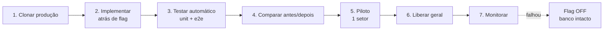

# ZORION SAÚDE — Plano de Profissionalização Incremental

> **Regra nº 1:** o banco de dados de hoje nunca deixa de funcionar.
> Nenhuma fase apaga, renomeia ou altera tipo de nada existente. Só adiciona.
> Toda mudança roda antes em um clone do banco real (`pg_dump` → `zorion_test`).

Diagrama visual: [`DIAGRAMA_PLANO.html`](./DIAGRAMA_PLANO.html)

---

## Fluxo geral

```mermaid
flowchart TD
    A([Início: v3.2.80 em produção]) --> F0

    subgraph F0[F0 · Rede de segurança · 2-3 dias]
      F0A[Backup automático + teste de restore]
      F0B[Tag git baseline-v3.2.80]
      F0C[Clone de produção → zorion_test]
      F0D[Roteiro de fumaça: 9 fluxos]
      F0A --> F0B --> F0C --> F0D
    end

    F0 --> G0{Gate: restore abre o app<br/>e 9/9 fluxos passam?}
    G0 -- não --> F0
    G0 -- sim --> F1

    subgraph F1[F1 · Segurança P0 · 1-2 semanas]
      F1A[Senha fora do localStorage]
      F1B[TLS + usuário PG dedicado]
      F1C[Fim do admin/admin123]
      F1D[Queries parametrizadas]
      F1E[CSP no Tauri]
    end

    F1 --> G1{Gate: 9/9 fluxos com banco original<br/>+ injeção bloqueada + sem TLS recusado?}
    G1 -- não --> F1
    G1 -- sim --> F2

    subgraph F2[F2 · Repositórios de dados · 2-4 semanas]
      F2A[SQL sai das telas]
      F2B[Validação com zod]
      F2C[Testes de contrato antigo x novo]
    end

    F2 --> G2{Gate: paridade 100%<br/>no clone?}
    G2 -- não --> F2
    G2 -- sim --> F3

    subgraph F3[F3 · Integridade aditiva · 1-2 semanas]
      F3A[Migrations versionadas]
      F3B[FKs NOT VALID + índices]
      F3C[Colunas tipadas em paralelo + trigger]
      F3D[Relatório de órfãos (leitura)]
    end

    F3 --> G3{Gate: migration idempotente<br/>+ contagem antes = depois?}
    G3 -- não --> F3
    G3 -- sim --> F4

    subgraph F4[F4 · Quebra de monólitos + CI · 3-5 semanas]
      F4A[Dividir PacientesMedicao e afins]
      F4B[Vitest + Playwright/Puppeteer]
      F4C[CI: lint, typecheck, unit, e2e]
    end

    F4 --> G4{Gate: cobertura dos 9 fluxos<br/>+ build Windows verde?}
    G4 -- não --> F4
    G4 -- sim --> F5

    subgraph F5[F5 · Permissões + auditoria · 2-3 semanas]
      F5A[Perfis no servidor]
      F5B[Auditoria append-only]
      F5C[Segregação de funções]
    end

    F5 --> G5{Gate: matriz de permissões<br/>por perfil + bypass falha?}
    G5 -- não --> F5
    G5 -- sim --> F6

    subgraph F6[F6 · Nível ERP · contínuo]
      F6A[Numeração de documentos]
      F6B[Fechamento de período]
      F6C[Compras: ABC, alçada, NF-e]
      F6D[Observabilidade + updater]
      F6E[LGPD + backup offsite]
    end

    F6 --> Z([Sistema profissional<br/>mesmo banco, mesma operação])
```

---

## Ciclo de teste (repetido em toda fase)



---

## Fases em detalhe

### F0 — Rede de segurança (2-3 dias)
**Objetivo:** garantir que existe volta antes de tocar em qualquer coisa.

- [ ] Script `scripts/backup.sh` (pg_dump diário, retenção 30 dias)
- [ ] Teste de restore documentado e cronometrado
- [ ] Tag `baseline-v3.2.80` no git
- [ ] Script `scripts/clone_prod_para_test.sh`
- [ ] Roteiro de fumaça: login, entrada, saída, satélite, inventário, livro 344, carrinho, relatórios, backup
- [ ] **Gate:** restaurar dump real, abrir o app, 9/9 fluxos OK
- **Muda no banco:** nada
- **Rollback:** não se aplica

### F1 — Segurança P0 (1-2 semanas)
**Objetivo:** fechar o que um auditor vê primeiro.

- [ ] Credenciais fora do `localStorage` (keyring do SO / arquivo protegido)
- [ ] TLS na conexão Postgres (`NoTls` → `Tls`)
- [ ] Usuário PG dedicado `zorion_app`, sem superuser, grants mínimos
- [ ] Remover `admin/admin123`, forçar troca no primeiro acesso
- [ ] Queries parametrizadas (eliminar interpolação em `db.js`)
- [ ] CSP no `tauri.conf.json` (hoje `null`)
- [ ] **Gate:** 9/9 fluxos no banco original + payload de injeção bloqueado + conexão sem TLS recusada
- **Muda no banco:** nada (só permissões de usuário)
- **Rollback:** flag `useLegacyConnection`

### F2 — Repositórios de dados (2-4 semanas)
**Objetivo:** tirar SQL das telas sem mudar resultado.

- [ ] `src/data/repositories/{estoque,saidas,satelite,pacientes,livro}.js`
- [ ] Validação de entrada com `zod`
- [ ] Testes de contrato: query antiga × query nova, mesmo JSON
- [ ] Erros estruturados (fim de `catch {}`)
- [ ] **Gate:** paridade 100% em clone, incluindo relatórios e somatórios
- **Muda no banco:** nada
- **Rollback:** telas continuam no caminho antigo até a paridade fechar

### F3 — Integridade aditiva (1-2 semanas)
**Objetivo:** blindar o banco sem quebrar dado legado.

- [ ] `database/migrations/0001_*.sql` numeradas e idempotentes
- [ ] FKs como `NOT VALID` (novos registros validados, legado ignorado)
- [ ] Índices: lote, medicamento, paciente, data de movimentação
- [ ] Colunas tipadas em paralelo (`TIMESTAMPTZ`, `NUMERIC`) + trigger de preenchimento
- [ ] Relatório de órfãos (somente leitura)
- [ ] **Gate:** migration 2× sem erro, contagem antes = depois, app antigo lendo tudo
- **Muda no banco:** só adições
- **Rollback:** script de down removendo apenas o criado na fase

### F4 — Quebra de monólitos + CI (3-5 semanas)
**Objetivo:** parar de ter medo de mexer.

- [ ] Dividir `PacientesMedicao.jsx` (5.611 linhas) em módulos
- [ ] Dividir `CarrinhoParada.jsx` (2.860) e `ResponsavelTecnico.jsx` (2.415)
- [ ] Vitest para regras de dose, cobertura, lote e validade
- [ ] E2E dos 9 fluxos com Puppeteer (já instalado) ou Playwright
- [ ] CI GitHub Actions: lint + typecheck + unit + e2e em banco clonado
- [ ] **Gate:** cobertura dos fluxos críticos + build Windows verde
- **Muda no banco:** nada
- **Rollback:** PRs pequenos, cada tela reversível

### F5 — Permissões + auditoria (2-3 semanas)
**Objetivo:** perfil de usuário deixa de ser detalhe de tela.

- [ ] Perfis aplicados no banco/API, não no React
- [ ] `Auditoria` append-only (revogar UPDATE/DELETE)
- [ ] Segregação: solicita ≠ aprova ≠ separa ≠ confere
- [ ] Exportação da trilha para auditoria
- [ ] **Gate:** matriz de permissões por perfil + tentativa de bypass falha
- **Muda no banco:** permissões + triggers de auditoria
- **Rollback:** modo observação (registra sem bloquear) antes de bloquear

### F6 — Nível ERP (contínuo)
**Objetivo:** o "padrão SAP" sem trocar de produto.

- [ ] Numeração de documentos (pedido, entrada, saída, lote)
- [ ] Fechamento de período de estoque + estorno com motivo
- [ ] Compras: curva ABC, ponto de pedido, alçada, NF-e
- [ ] Observabilidade: logs, healthcheck, updater assinado
- [ ] LGPD: retenção, anonimização, backup offsite
- [ ] **Gate:** simulação de auditoria ANVISA/CFM + restore em ambiente limpo

---

## Guardrails

**Permitido:** `CREATE TABLE IF NOT EXISTS`, `ADD COLUMN IF NOT EXISTS`, `CREATE INDEX IF NOT EXISTS`, `ADD CONSTRAINT ... NOT VALID`, migrations idempotentes com down, triggers de sincronização.

**Proibido:** `DROP`, `RENAME`, `ALTER TYPE` em coluna em uso, `DELETE`/`UPDATE` em massa sem backup, migration direto em produção sem clone, publicar sem gate verde.

---

## Cronograma estimado

| Fase | Duração | Acumulado |
|---|---|---|
| F0 | 2-3 dias | semana 1 |
| F1 | 1-2 semanas | semana 2-3 |
| F2 | 2-4 semanas | semana 4-6 |
| F3 | 1-2 semanas | semana 7-8 |
| F4 | 3-5 semanas | semana 9-12 |
| F5 | 2-3 semanas | semana 13-14 |
| F6 | contínuo | a partir da 15 |

> Cada fase só começa depois do seu gate verde. Você aprova antes de avançar.
